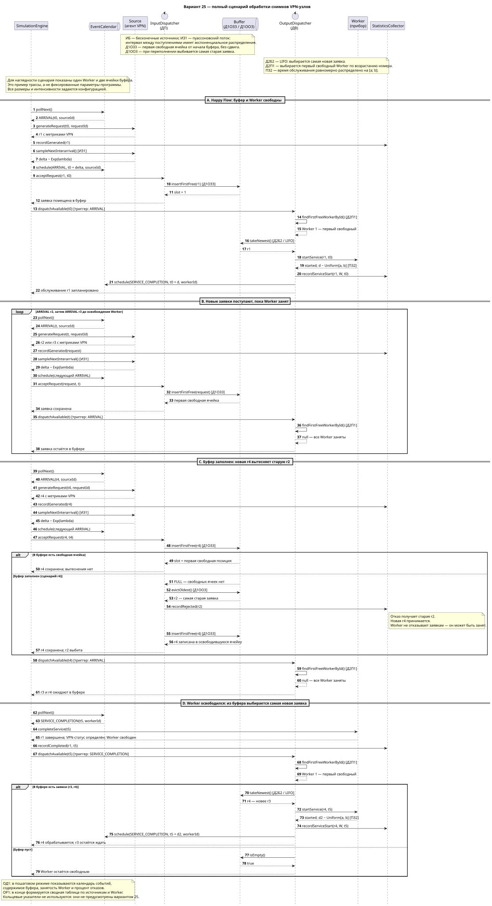
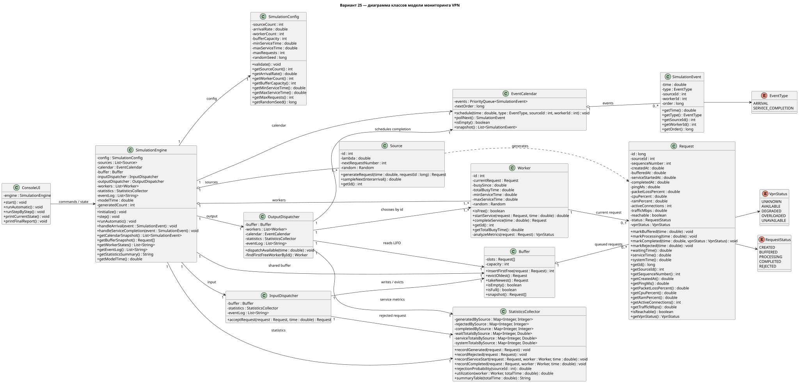
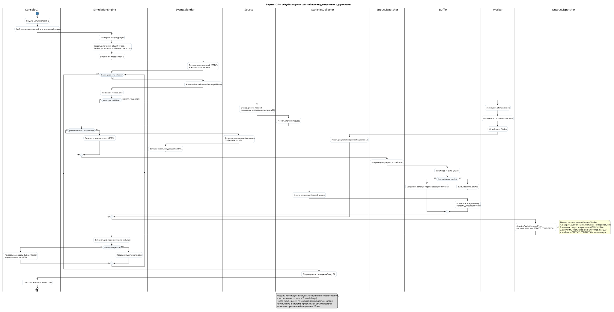

# Мониторинг VPN-инфраструктуры — вариант 25

**Черепков Илья**  
Группа **5130904/40106**

На каждом VPN-сервере агент мониторинга формирует снимки состояния узла и отправляет их в центральную систему. Каждый снимок поступает в общий ограниченный буфер. Если есть свободный обработчик, он сразу забирает снимок. При перегрузке система сохраняет более свежие данные: когда буфер заполнен, новый снимок вытесняет самый старый из ожидающих. Модель позволяет оценить, сколько снимков теряется, как долго они ждут обработки и насколько загружены обработчики.

## Элементы модели

| Элемент СМО | Бизнес-сущность |
| --- | --- |
| Источник | Агент мониторинга на VPN-сервере, который формирует снимки состояния своего узла. |
| Заявка | Один снимок состояния VPN-узла. В модели фиксируются источник, порядковый номер снимка и время его формирования. |
| Буфер | Общая очередь с фиксированным числом ячеек для снимков, ожидающих обработки. |
| Прибор | Обработчик центральной системы, который обслуживает один снимок за раз. |
| Диспетчер постановки | Размещает поступивший снимок в буфере. При заполнении освобождает ячейку, вытесняя самый старый ожидающий снимок. |
| Диспетчер выбора | Выбирает самый свежий ожидающий снимок и передаёт его свободному обработчику с наименьшим номером. |
| Отказ | Вытеснение ожидающего снимка. Отказ учитывается у агента, который сформировал вытесненный снимок. |

## Формула варианта

**ИБ ИЗ1 ПЗ2 Д1ОЗ3 Д1ОО3 Д2П1 Д2Б2 ОР1 ОД1**

| Код | Правило модели |
| --- | --- |
| ИБ | Каждый агент формирует новые снимки независимо от завершения обработки предыдущих. |
| ИЗ1 | Поток снимков от каждого агента пуассоновский. Интервалы между последовательными поступлениями от одного агента распределены экспоненциально. |
| ПЗ2 | Время обработки одного снимка равномерно распределено в заданных границах. |
| Д1ОЗ3 | Диспетчер помещает снимок в первую свободную ячейку от начала буфера. Остальные снимки сохраняют свои позиции. |
| Д1ОО3 | Если при поступлении буфер полон, отказ получает снимок, который ожидает дольше всех. Новый снимок занимает его ячейку. |
| Д2П1 | Поиск свободного обработчика каждый раз начинается с первого. Среди свободных выбирается обработчик с наименьшим номером. |
| Д2Б2 | Из буфера выбирается снимок, поступивший последним (LIFO). Выбор определяется временем поступления независимо от номера ячейки. |
| ОР1 | В автоматическом режиме выводятся таблицы по источникам и приборам: число заявок и отказов, вероятность отказа, средние времена ожидания, обслуживания и пребывания в системе, дисперсии времени ожидания и обслуживания, коэффициенты использования приборов. |
| ОД1 | В пошаговом режиме после события отображаются таблица будущих событий, счётчики источников, содержимое ячеек буфера, состояние приборов и текущий процент отказов. |

## Первичные артефакты

### 1. Диаграмма последовательности

[Исходник PlantUML](diagrams/sequence.puml) · [Открыть SVG](diagrams/imgs/sequence.svg)

### 2. Диаграмма классов

[Исходник PlantUML](diagrams/class-diagram.puml) · [Открыть SVG](diagrams/imgs/class-diagram.svg)

### 3. Блок-схема алгоритма

[Исходник PlantUML](diagrams/general-flowchart.puml) · [Открыть SVG](diagrams/imgs/general-flowchart.svg)

| Подпроцесс | Исходник | Блок-схема |
| --- | --- | --- |
| A. Генерация заявки, постановка в буфер и вытеснение | [PlantUML](diagrams/subprocess-a.puml) | [SVG](diagrams/imgs/subprocess-a.svg) |
| B. Выбор заявки из буфера и назначение прибора | [PlantUML](diagrams/subprocess-b.puml) | [SVG](diagrams/imgs/subprocess-b.svg) |
